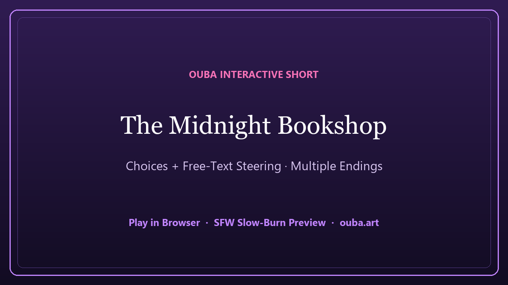

# `@ouba-studio/branching-story-kit`

**Zero-dependency branching narrative engine for interactive fiction, visual novels, and romance story apps** — story-graph state tracking, gated choices, a persistent memory log, save/restore, a static validator, and a JSON Schema. Native ESM, TypeScript declarations, MIT.

[](https://www.npmjs.com/package/@ouba-studio/branching-story-kit)
[](https://jsr.io/@ouba-studio/branching-story-kit)
[](https://doi.org/10.5281/zenodo.24514910)
[](https://doi.org/10.7910/DVN/YEBHQR)
[](https://ouba-studio.github.io/branching-story-kit/)
[](https://ouba-art.itch.io/the-midnight-bookshop)
[](https://ifdb.org/viewgame?id=ku32o1jvi5fnb95q)
[](https://www.ouba.art/)
[](./LICENSE)
[](./package.json)
[](https://github.com/ouba-studio/branching-story-kit/actions/workflows/ci.yml)
[](./test.mjs)

**Mirrors & ecosystem:** [SourceForge mirror](https://sourceforge.net/projects/ouba-story-kit/) (release files + Git) · [Read the Docs](https://branching-story-kit.readthedocs.io/en/latest/) · [Bitbucket mirror](https://bitbucket.org/ouba-studio/branching-story-kit/src/main/) · [GitLab mirror](https://gitlab.com/ouba-studio/branching-story-kit) · [branching-story-mcp](https://github.com/ouba-studio/branching-story-mcp) ([Glama rated A](https://glama.ai/mcp/servers/ouba-studio/branching-story-mcp) · [mcpservers.org](https://mcpservers.org/servers/ouba-studio/branching-story-mcp) · [GitLab](https://gitlab.com/ouba-studio/branching-story-mcp)) · [Pinterest benchmark board](https://www.pinterest.com/oubastudio_research/interactive-romance-ai-story-benchmarks-2026/) · [Spotify podcast](https://open.spotify.com/show/1w0GB08z1B7YwBXMtraDS3)

[](https://sourceforge.net/projects/ouba-story-kit/)
[](https://branching-story-kit.readthedocs.io/en/latest/)
[](https://bitbucket.org/ouba-studio/branching-story-kit/src/main/)
[](https://gitlab.com/ouba-studio/branching-story-kit)
[](https://gitlab.com/ouba-studio/branching-story-mcp)
[](https://open.spotify.com/show/1w0GB08z1B7YwBXMtraDS3)
[](https://glama.ai/mcp/servers/ouba-studio/branching-story-mcp)
[](https://mcpservers.org/servers/ouba-studio/branching-story-mcp)
[](https://www.pinterest.com/oubastudio_research/interactive-romance-ai-story-benchmarks-2026/)

Built in the open by **[Ouba Studio](https://www.ouba.art/)** — the team behind [Ouba](https://www.ouba.art/), free reader-first interactive fiction on **web, iOS, and Android**, and the [2026 AI Story Apps Benchmark](https://www.ouba.art/i-tested-ai-story-apps) (open data on [CERN Zenodo](https://doi.org/10.5281/zenodo.24511974), [Harvard Dataverse](https://doi.org/10.7910/DVN/YEBHQR), and [Figshare](https://doi.org/10.6084/m9.figshare.35110510.v1)).

---

## 🎮 Play the demo — *The Midnight Bookshop*

A four-scene rivals-to-lovers branching romance with relationship meters, an inventory item, a trust-gated choice, a free-text steering moment, and four endings. It is a plain JSON manifest played by the real engine — no framework, no build step.

| Where | Link |
| :--- | :--- |
| **GitHub Pages (live, runs on this engine)** | https://ouba-studio.github.io/branching-story-kit/ |
| **itch.io (HTML5 build)** | https://ouba-art.itch.io/the-midnight-bookshop |
| **IFDB — Interactive Fiction Database** | https://ifdb.org/viewgame?id=ku32o1jvi5fnb95q |
| **Hugging Face Space (mirror)** | https://huggingface.co/spaces/oubaapp/the-midnight-bookshop |
| **Headless in your terminal** | `node examples/run.mjs --all` |



> Want full-length stories where your choices and typed lines carry across 20+ turns with real memory? **Read free on [Ouba](https://www.ouba.art/)** — web, iOS, and Android.

---

## Why `branching-story-kit`?

Most "interactive story" tooling is either a full game engine or a blank chat box. This kit is the small, boring, reliable layer in between: **a JSON story graph with explicit state**, so that what a reader did in turn 2 is still true in turn 15.

- **Zero dependencies** — one `.mjs` file, pure ESM, runs in Node ≥ 18 and every modern browser. `dependencies: {}`.
- **Relationship & flag state** — numeric effects *add*, everything else *assigns*; `requires` gates choices behind thresholds.
- **Persistent memory log** — `engine.remember("My cat's name is Marmalade.")` records reader-planted facts with turn numbers so long sessions don't drift.
- **`{{state}}` interpolation** in prose, with unknown placeholders left intact.
- **Free-text steering** — `set()` + `jump()` let typed input branch the plot without leaving the manifest.
- **Save / restore** — `exportSave()` → `StoryEngine.importSave()` round-trips cursor, state, history, and memory.
- **Static validator + JSON Schema** — catch broken `next` links before you publish; validate manifests in your editor or CI.
- **TypeScript declarations** shipped in the box.

## Install

```bash
npm install @ouba-studio/branching-story-kit
```

```bash
pnpm add @ouba-studio/branching-story-kit
# or
yarn add @ouba-studio/branching-story-kit
```

**JSR (Deno / Bun / Node with `jsr:` specifiers) — no `node_modules`, no build step:**

```bash
deno add jsr:@ouba-studio/branching-story-kit
# or import it directly:
# import { StoryEngine, validateStory } from "jsr:@ouba-studio/branching-story-kit@1";
```

Package page: **https://jsr.io/@ouba-studio/branching-story-kit**

## Quickstart via jsDelivr (no install)

One file, zero dependencies — drop it straight into a `<script type="module">` tag or an
`import()` call. jsDelivr serves the tagged GitHub release with a global CDN cache, so the
same URL works in a blog post, a CodePen, or a university writing-lab handout:

```html
<script type="module">
  import { StoryEngine, validateStory } from
    "https://cdn.jsdelivr.net/gh/ouba-studio/branching-story-kit@v1.0.0/index.mjs";

  const story = {
    id: "two-scenes",
    start: "door",
    initialState: { trust: 1 },
    scenes: {
      door: {
        title: "The Door",
        body: "The lamp is still on.",
        choices: [{ label: "Knock", next: "inside", effects: { trust: 2 } }],
      },
      inside: { title: "Inside", body: "Trust = {{trust}}.", ending: true },
    },
  };

  if (validateStory(story).valid) {
    const engine = new StoryEngine(story);
    engine.choose(0);
    document.body.textContent = engine.current().body; // "Trust = 3."
  }
</script>
```

Pin the version for anything you ship: `@v1.0.0` is immutable, `@main` tracks `HEAD`.

| Channel | Import specifier |
| :--- | :--- |
| **jsDelivr (GitHub release, pinned)** | `https://cdn.jsdelivr.net/gh/ouba-studio/branching-story-kit@v1.0.0/index.mjs` |
| **jsDelivr (npm mirror)** | `https://cdn.jsdelivr.net/npm/@ouba-studio/branching-story-kit@1.0.0/index.mjs` |
| **JSR** | `jsr:@ouba-studio/branching-story-kit@1` → https://jsr.io/@ouba-studio/branching-story-kit |
| **npm** | `@ouba-studio/branching-story-kit` |
| **GitHub Pages (live interactive demo)** | https://ouba-studio.github.io/branching-story-kit/ |

## Quickstart (npm)

```js
import { StoryEngine, validateStory } from "@ouba-studio/branching-story-kit";

const story = {
  id: "midnight-bookshop",
  start: "arrival",
  initialState: { spark: 1, trust: 1, item: "cardamom tea" },
  scenes: {
    arrival: {
      title: "Rain on Bellweather Lane",
      body: "Julian slides a warm mug of {{item}} across the counter.",
      choices: [
        { label: "Hold his gaze", next: "stacks", effects: { spark: 2 } },
        { label: "Ask about the folio", next: "stacks", effects: { trust: 2 }, requires: { trust: 2 } },
      ],
    },
    stacks: {
      title: "Between the Stacks",
      body: "The lantern glows amber as he opens the fourth folio. Spark = {{spark}}, trust = {{trust}}.",
      ending: true,
      choices: [{ label: "Continue on Ouba →", href: "https://www.ouba.art/" }],
    },
  },
};

console.log(validateStory(story)); // { valid: true, errors: [] }

const engine = new StoryEngine(story);
engine.remember("My cat's name is Marmalade."); // memory log
console.log(engine.current().choices.length); // 1 — the trust-gated choice is hidden

engine.choose(0); // apply effects, advance to "stacks"
console.log(engine.current().body); // "... Spark = 3, trust = 1."
console.log(engine.exportSave()); // {"storyId":"midnight-bookshop","sceneId":"stacks",...}
```

### TypeScript

```ts
import { StoryEngine, validateStory, type StoryManifest } from "@ouba-studio/branching-story-kit";

const story: StoryManifest = {
  start: "intro",
  scenes: {
    intro: {
      title: "Rain on the Glass",
      body: "Welcome back, {{reader}}.",
      choices: [{ label: "Begin", next: "end", effects: { trust: 1 } }],
    },
    end: { title: "Shared Lamp", body: "Trust rose to {{trust}}.", ending: true },
  },
};

if (validateStory(story).valid) {
  const engine = new StoryEngine(story, { reader: "Clara", trust: 0 });
  const ending = engine.choose(0); // fully typed SceneView
}
```

## Story manifest

A manifest is `{ start, scenes }` plus optional metadata. Scene bodies are strings (paragraph breaks with `\n\n`); `{{key}}` placeholders interpolate from state. Choices may point to a `next` scene **or** an external `href`.

```json
{
  "id": "the-midnight-bookshop",
  "title": "The Midnight Bookshop",
  "start": "start",
  "initialState": { "spark": 1, "trust": 1, "item": "none", "customLine": "" },
  "scenes": {
    "start": {
      "tag": "Scene 1 of 4",
      "title": "Rain on Bellweather Lane",
      "body": "The brass bell above Bellweather Rare Books chimes at 11:48 PM…",
      "choices": [
        { "label": "Take the mug and hold his gaze.", "next": "glimpse", "effects": { "spark": 2, "item": "Cardamom Tea" } },
        { "label": "Open the full story on Ouba →", "href": "https://www.ouba.art/" }
      ]
    },
    "glimpse": { "title": "Between the Stacks", "body": "…", "ending": true }
  }
}
```

The full contract lives in **[`story.schema.json`](./story.schema.json)** (JSON Schema 2020-12). Import it in your editor with `@ouba-studio/branching-story-kit/story.schema.json`.

### Choice fields

| Field | Type | Meaning |
| :--- | :--- | :--- |
| `label` | `string` | Text shown to the reader (required). |
| `next` | `string` | Scene id to advance to (required unless `href` is set). |
| `requires` | `Record<string, number>` | Minimum numeric state values for the choice to be **visible**. |
| `effects` | `Record<string, number \| string \| boolean>` | Applied when chosen — numbers **add** to the current value, strings/booleans **assign**. |
| `href` | `string` | External link (store page, sequel, survey). `choose()` refuses it; your UI opens it. |

## API

| Member | Signature | Notes |
| :--- | :--- | :--- |
| `StoryEngine` | `new StoryEngine(story, initialState?)` | One instance per reader session; throws on invalid manifests. |
| `engine.turn` | `number` | Scene visits so far (the start scene is turn 1). |
| `engine.current()` | `SceneView` | `{ id, title, body, choices, ending, state }` with gated choices filtered out and `{{…}}` interpolated. |
| `engine.choose(index)` | `SceneView` | Picks a **visible** choice by index; applies `effects`; advances to `next`. |
| `engine.jump(sceneId, effects?)` | `SceneView` | Direct navigation for free-text steering and scripted transitions. |
| `engine.set(key, value)` | `StoryState` | Writes a single state value (player name, typed line, runtime flag). |
| `engine.remember(fact)` | `MemoryEntry[]` | Appends `{ turn, fact }` to the memory log; blank facts are ignored. |
| `engine.interpolate(text)` | `string` | Replaces `{{key}}` placeholders; unknown keys are left intact. |
| `engine.exportSave()` | `string` | JSON with `storyId`, `sceneId`, `state`, `history`, `memory`. |
| `StoryEngine.importSave(json, story)` | `StoryEngine` | Restores a session; validates the scene cursor exists. |
| `validateStory(story)` | `{ valid, errors }` | Static check: start scene exists, every `next` resolves, choices are labelled, scenes have bodies. Never throws. |

## Saves

```js
const json = engine.exportSave();               // persist anywhere (localStorage, your DB…)
const restored = StoryEngine.importSave(json, story);
restored.memory; // same facts, same turn numbers
restored.current(); // identical SceneView to the moment of export
```

## Validation & CI

```bash
npm test                      # node --test test.mjs  (21 tests, zero dependencies)
npm run example               # headless play-through of every route in the demo story
npm run build:docs            # refresh docs/engine.mjs + docs/story.mjs for GitHub Pages
```

`validateStory()` is designed for CI: run it over every manifest in your repo and fail the build on `valid === false`.

## Why memory matters: the 2026 AI Story Apps Benchmark

`remember()` exists because of what the Ouba Studio research team measured in the open, reproducible [2026 AI Story Apps Benchmark](https://www.ouba.art/i-tested-ai-story-apps) (evaluation date `2026-11-15`): across 10 prominent AI story and companion apps, a trivial fact planted at turn 2 (*"My cat's name is Marmalade."*) was **forgotten by turn 15** by several major products, and free-tier walls stopped others before turn 15 at all. Explicit story state plus a factual memory log is the deterministic fix for authored branching fiction.

| Artifact | Persistent identifier |
| :--- | :--- |
| Primary dataset (CERN Zenodo) | [10.5281/zenodo.24511974](https://doi.org/10.5281/zenodo.24511974) |
| Harvard Dataverse (`.edu`) | [10.7910/DVN/YEBHQR](https://doi.org/10.7910/DVN/YEBHQR) |
| Figshare | [10.6084/m9.figshare.35110510.v1](https://doi.org/10.6084/m9.figshare.35110510.v1) |
| Executive deck (CERN Zenodo) | [10.5281/zenodo.24511982](https://doi.org/10.5281/zenodo.24511982) |
| Interactive benchmark site | https://ai-story-benchmark-2026.vercel.app/ |
| Hugging Face Datasets | https://huggingface.co/datasets/oubaapp/ai-story-apps-benchmark-2026 |
| Benchmark source repository | https://github.com/ouba-studio/ai-story-apps-benchmark-2026 |
| Benchmark source repository (GitLab mirror) | https://gitlab.com/ouba-studio/ai-story-apps-benchmark-2026 |
| Interactive benchmark explorer (ouba.art) | https://www.ouba.art/tools/benchmark-explorer |
| Reader-First podcast (Spotify) | https://open.spotify.com/show/1w0GB08z1B7YwBXMtraDS3 |

## Repository layout

```
branching-story-kit/
├── index.mjs                  # the engine (zero dependencies)
├── index.d.ts                 # TypeScript declarations
├── story.schema.json          # JSON Schema for story manifests
├── jsr.json                   # JSR (jsr.io) package manifest — @ouba-studio/branching-story-kit
├── test.mjs                   # node --test suite (21 tests)
├── examples/
│   ├── midnight-bookshop.mjs  # the demo story as a manifest
│   └── run.mjs                # headless play-through (npm run example)
├── docs/                      # GitHub Pages showcase (docs/index.html)
│   ├── engine.mjs             # generated copy of index.mjs (npm run build:docs)
│   └── story.mjs              # generated copy of the demo manifest
├── scripts/build-docs.mjs
├── CITATION.cff · CHANGELOG.md · LICENSE
└── .github/workflows/ci.yml   # node --test on Node 18/20/22/24
```

## Citation

If you use `branching-story-kit` in research, a product, or a game, cite:

> Ouba Studio (2026). *branching-story-kit: A zero-dependency branching narrative engine for interactive fiction, visual novels, and romance story apps* (v1.0.0) [Computer software]. MIT License. https://doi.org/10.5281/zenodo.24514910

```bibtex
@software{ouba_studio_2026_branching_story_kit,
  author  = {{Ouba Studio}},
  title   = {branching-story-kit: A zero-dependency branching narrative engine for interactive fiction, visual novels, and romance story apps},
  year    = {2026},
  version = {1.0.0},
  publisher = {CERN Zenodo},
  doi     = {10.5281/zenodo.24514910},
  url     = {https://github.com/ouba-studio/branching-story-kit},
  license = {MIT},
  note    = {Ouba Studio, \url{https://www.ouba.art/}}
}
```

Machine-readable metadata: [`CITATION.cff`](./CITATION.cff).

### Permanent identifiers

| Artifact | Identifier |
| :--- | :--- |
| **This software (Zenodo, v1.0.0)** | [10.5281/zenodo.24514910](https://doi.org/10.5281/zenodo.24514910) |
| npm package | [`@ouba-studio/branching-story-kit`](https://www.npmjs.com/package/@ouba-studio/branching-story-kit) |
| JSR package | [`@ouba-studio/branching-story-kit`](https://jsr.io/@ouba-studio/branching-story-kit) |
| GitHub release | [`v1.0.0`](https://github.com/ouba-studio/branching-story-kit/releases/tag/v1.0.0) |
| SourceForge mirror | [`ouba-story-kit`](https://sourceforge.net/projects/ouba-story-kit/) — release files (tarball, benchmark PDF) + Git mirror |
| GitLab mirrors | [`ouba-studio/branching-story-kit`](https://gitlab.com/ouba-studio/branching-story-kit) · [`ouba-studio/branching-story-mcp`](https://gitlab.com/ouba-studio/branching-story-mcp) · [`ouba-studio/ai-story-apps-benchmark-2026`](https://gitlab.com/ouba-studio/ai-story-apps-benchmark-2026) |
| Podcast | *Reader-First: Interactive Romance & AI Story Apps* — [Spotify](https://open.spotify.com/show/1w0GB08z1B7YwBXMtraDS3) · [RSS](https://ouba-podcasts.vercel.app/feed.xml) |
| Read the Docs | <https://branching-story-kit.readthedocs.io/en/latest/> |
| MCP server | [branching-story-mcp](https://github.com/ouba-studio/branching-story-mcp) · [Glama rated A](https://glama.ai/mcp/servers/ouba-studio/branching-story-mcp) · [mcpservers.org](https://mcpservers.org/servers/ouba-studio/branching-story-mcp) |
| Live demo | https://ouba-studio.github.io/branching-story-kit/ |

### Use it in a classroom

`branching-story-kit` is the engine behind the open writing-lab exercises on
**[Ouba+ for Students](https://www.ouba.art/students)** — MIT-licensed, zero dependencies, and
small enough to read in one sitting, which is the point: students edit a JSON manifest and watch
state, gating, and memory behave deterministically. Verified `.edu` / accredited-university
students also get [Ouba+ free](https://www.ouba.art/students) for full-length reading.

## License

[MIT](./LICENSE) © 2026 Ouba Studio. Use it in commercial games, embed it in apps, ship it — just keep the notice.

## Ouba

- **Play interactive romance & fiction free** — https://www.ouba.art/ (web · iOS · Android)
- **Ouba+ for Students** — verified `.edu` / accredited-university students get 100% free Ouba+ (no card, no auto-billing): https://www.ouba.art/students
- **The 2026 AI Story Apps Benchmark** — https://www.ouba.art/i-tested-ai-story-apps
- **Cite this kit** — Zenodo DOI [10.5281/zenodo.24514910](https://doi.org/10.5281/zenodo.24514910)
- **Contact** — team@ouba.art
